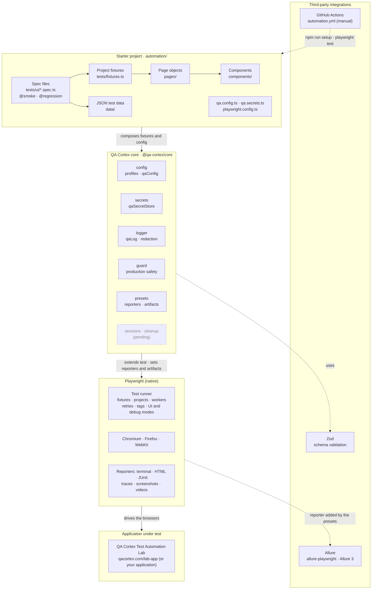

# QA Cortex

A thin, composition-first extension layer over [Playwright](https://playwright.dev) for
TypeScript test automation, plus a ready-to-use starter project. QA Cortex adds what Playwright
leaves to each team: typed environment configuration, secrets, redacting logs, production
safety checks and reporting presets. It never replaces Playwright's runner, `test`, `expect`,
locators or actions, and raw Playwright always stays usable.

> **Status: early development.** Release 1 targets GUI/web automation. `@qa-cortex/core` is
> not published to npm yet; the starter project builds it from this repository.

## Why QA Cortex

- **Start writing tests in minutes:** clone, `npm run setup`, `npm test`. The starter project
  already has page objects, test data, fixtures, cross-browser projects, reports and a CI workflow.
- **One typed configuration for every environment:** profiles such as `local`, `staging` and
  `production`, validated before any browser starts, with readable errors.
- **Secrets handled deliberately:** read from the environment or `.env`, typed, never printed,
  redacted from QA Cortex logs.
- **Safe production runs:** the production guard refuses to record traces, videos or
  screenshots in a production profile.
- **Plain Playwright underneath:** no base page class, no wrapped actions, no custom runner.
  Everything you know about Playwright applies, and every module works on its own.

## What's included

| Area | What you get | Provided by |
|---|---|---|
| Configuration | typed schema, environment profiles, startup validation, `qaConfig` fixture | QA Cortex core |
| Secrets | `defineSecrets`, `loadSecrets`, typed `Secret` values, `qaSecretStore` fixture | QA Cortex core |
| Logging | structured, levelled `qaLog` with redaction and a per-test log attachment | QA Cortex core |
| Production guard | static and runtime checks against recording artifacts in production | QA Cortex core |
| Reporting presets | reporters and trace/video/screenshot settings for local, CI and production | QA Cortex core |
| Test design | page objects, a reusable component, page object fixtures, JSON data, data-driven tests | Starter project |
| Execution | Chromium, Firefox and WebKit; parallel runs; retries; timeouts; `@smoke`/`@regression` tags; headed, UI and debug modes | Playwright, configured by the starter project |
| Reports | terminal, HTML, JUnit, Allure; traces, screenshots and videos on failure | Playwright, Allure, QA Cortex presets |
| CI/CD | manual GitHub Actions workflow with browser, profile and tag choices | Starter project, GitHub Actions |

The full list, with status and references, is in the
[feature inventory](framework/docs/feature-inventory.md).

## Technology stack

- **Language:** TypeScript 6.0.3 (ESM), Node.js 22.12+ (22.18+ for the starter project)
- **Test runner:** Playwright Test 1.65.1 (`@qa-cortex/core` supports `>=1.60.0 <2` as a peer dependency)
- **Validation:** Zod 4 (re-exported as `z` for schema extensions)
- **Reporting:** Playwright reporters; Allure (`allure-playwright` with the Allure 3 report generator)
- **Quality:** ESLint 9 with typescript-eslint (type-aware rules)
- **CI/CD:** GitHub Actions
- **Packaging:** npm workspaces (`framework/`), packed tarball until npm publishing

## Architecture



- **Starter project:** your tests, page objects, data and configuration files. You own and
  change everything here.
- **QA Cortex core:** fixture factories and helpers that your project composes into its own
  `test` and `playwright.config.ts`. The modules never import each other.
- **Playwright:** runs everything: tests, browsers, parallelism, reports and artifacts.
- **Third-party:** Zod (inside the core), and Allure and GitHub Actions (in the starter project).
- **Dashed:** planned modules that are not available yet.

## Repository structure

One GitHub repository, two independent npm projects, each with its own `package.json` and
lockfile:

```
framework/              framework development and npm packaging (see framework/README.md)
  packages/core/        @qa-cortex/core: config (ADR 0002), logger (ADR 0007), secrets and guard (ADR 0008), presets (ADR 0009)
  compat/               packed-package consumer checks
  docs/                 architecture decision records (adr/) and the feature inventory
  spikes/               M0 technical spikes, kept as history
automation/             ready-to-use starter project (see automation/README.md)
  pages/, components/   page objects and reusable UI components
  data/                 JSON test data
  tests/                project fixtures and browser tests (public websites; not part of framework CI)
  docs/                 manual acceptance checklist
  scripts/              setup, demos and the framework packing helper
  vendor/               packed @qa-cortex/core tarball until the package is published
.github/workflows/      CI and Compatibility (framework/), and Automation tests (automation/, manual only)
```

## Quick start

**Prerequisites:** Node.js **22.18 or later** for the starter project (22.12 or later for
`@qa-cortex/core` alone), npm and Git. No Java is needed.

```powershell
git clone https://github.com/QACortex/qa-cortex-framework.git
cd qa-cortex-framework/automation
npm run setup
npm test
```

`npm run setup` builds and packs the framework, installs the project's dependencies, creates
`.env` from `.env.example` and installs Chromium. See
[automation/README.md](automation/README.md#setup-once-inside-automation) for the individual
steps, other browsers and Linux.

Until `@qa-cortex/core` is published, `automation/` installs it from a packed tarball
(`file:vendor/qa-cortex-core.tgz`). This is temporary: it must be replaced with the published
npm dependency before Release 1 (steps in [automation/README.md](automation/README.md#setup-once-inside-automation)).

## Running tests

From `automation/`:

```powershell
npm test                                   # every test, Chromium, headless
npm run test:smoke                         # @smoke tests
npm run test:all                           # Chromium, Firefox and WebKit
npm test -- tests/ui/text-box.spec.ts      # one file
npm test -- -g "Cardiff"                   # by test name
npm run test:headed                        # with a visible browser
npm run test:ui                            # Playwright UI mode
```

The sample tests run against the [QA Cortex Test Automation Lab](https://qacortex.com/lab-app/),
a public practice application built for this project. Every option is in
[Running tests](automation/README.md#running-tests).

## Reporting and CI/CD

- **Reports:** terminal output, the Playwright HTML report (`npm run report`), JUnit XML
  (`reports/junit.xml`) and Allure (`npm run allure:generate`, then `npm run allure:open`).
  Failed tests keep their trace, screenshot, video and QA Cortex log.
- **Presets:** QA Cortex chooses reporters and artifacts for `local`, `ci` and `production`
  runs. Production runs record no traces, videos or screenshots, and the guard enforces it.
- **GitHub Actions:** `.github/workflows/automation.yml` runs the starter project's tests on
  demand. You choose the browser, profile and tags; reports are uploaded even when tests fail.
  The framework's own checks (`ci.yml`, `compatibility.yml`) run on every pull request.

Details: [Reports](automation/README.md#reports) and [GitHub Actions](automation/README.md#github-actions).

## Documentation

| Document | For |
|---|---|
| [automation/README.md](automation/README.md) | using the starter project: setup, writing tests, running, reports, CI, troubleshooting |
| [automation/docs/acceptance-checklist.md](automation/docs/acceptance-checklist.md) | a step-by-step first-use checklist |
| [framework/docs/feature-inventory.md](framework/docs/feature-inventory.md) | every feature, its status and where it is documented |
| [Core modules](#core-modules) (below) | the `@qa-cortex/core` APIs |
| [framework/README.md](framework/README.md) | developing and testing the framework itself |
| [framework/docs/adr/](framework/docs/adr/) | architecture decision records |

## Known limitations

- **Not on npm yet:** `@qa-cortex/core` is installed from a tarball built in this repository.
- **Redaction covers QA Cortex logs only:** Playwright traces, screenshots, videos, HTML
  reports and Allure results are not redacted. Treat them as sensitive and keep them private
  ([ADR 0003](framework/docs/adr/0003-s3-trace-secrets.md)).
- **Public sample application:** the sample tests need the QA Cortex Test Automation Lab to be
  reachable.
- **Platforms:** Linux and Windows are tested; macOS is not.

## Roadmap

| Area | Status |
|---|---|
| Authentication: roles and reusable sessions for browser and API tests | in development (paused) |
| Test data cleanup registry | planned (Release 1) |
| Shared ESLint and TypeScript configuration packages | planned (Release 1) |
| Publishing `@qa-cortex/core` to npm | planned (Release 1) |
| API automation package | later phase |
| AI agent integration | later phase |
| Visual and accessibility testing examples | deferred |

None of these are available yet; see the [feature inventory](framework/docs/feature-inventory.md).

## Working on the framework

```powershell
cd framework
npm ci
npm test
```

All framework commands (build, typecheck, lint, test, package checks), the CI workflows and
the compatibility matrix are described in [framework/README.md](framework/README.md).
Browser tests that visit public websites are not part of the framework checks.

## Core modules

Each module is a separate subpath of `@qa-cortex/core` and works without the others. The
starter project (`automation/`) uses all of them.

## Configuration (`@qa-cortex/core/config`)

Layered, validated, frozen configuration. Precedence: schema defaults → `base` → selected
profile → `overrides`. The profile comes from `loadConfig({ profile })`, then the
`QA_CORTEX_PROFILE` environment variable, then `defaultProfile`, then `"local"`.

```ts
// qa.config.ts
import { coreSchema, defineQaConfig, z, type ConfigOf } from '@qa-cortex/core/config';

export const schema = coreSchema.extend({
  app: z.strictObject({ tenant: z.string() }), // use the re-exported `z`
});
export type AppConfig = ConfigOf<typeof schema>;

export const qaConfig = defineQaConfig({
  schema, // omit to use coreSchema as-is
  base: { baseURL: 'http://localhost:3000', app: { tenant: 'acme' } },
  profiles: {
    local: {},
    staging: { baseURL: 'https://staging.example.com' },
  },
});
```

```ts
// playwright.config.ts: Playwright's own config stays in charge
import { defineConfig } from '@playwright/test';
import { loadConfig } from '@qa-cortex/core/config';
import { qaConfig } from './qa.config.js';

const qa = loadConfig(qaConfig); // validates now; a bad profile fails before any worker starts

export default defineConfig({
  use: { baseURL: qa.baseURL },
});
```

- Invalid config throws a `ConfigError` listing every issue with the layer that caused it
  (`[profile "staging"]`, `[not set in base, profile "staging"]`). Values are never printed.
- The result is deep-frozen; `profile` holds the selected profile name.
- `api` and `ai` are reserved top-level sections for future packages.
- The core schema holds only `baseURL`, `production`, `api` and `ai`. Playwright settings
  (timeouts, retries, workers) stay in Playwright's config. To vary one per profile, add
  your own field and map it explicitly:

  ```ts
  const schema = coreSchema.extend({
    timeouts: z.strictObject({ action: z.number().int().nonnegative() }).optional(),
  });
  // playwright.config.ts
  use: { baseURL: qa.baseURL, actionTimeout: qa.timeouts?.action },
  ```

### Config in tests: `configFixtures()`

Add the config fixtures to **your own** `test` with Playwright's `test.extend()`. QA Cortex
never replaces `test` or `expect`.

```ts
// tests/fixtures.ts
import { test as base } from '@playwright/test';
import { configFixtures, type ConfigWorkerFixtures } from '@qa-cortex/core/config';
import { qaConfig, type schema } from '../qa.config.js';

export const test = base.extend<object, ConfigWorkerFixtures<typeof schema>>(configFixtures(qaConfig));

// any spec
test('uses the config', async ({ page, qaConfig }) => {
  await page.goto('./');
  // qaConfig is typed from your schema, frozen, and loaded once per worker
});
```

| Fixture | Scope | What it is |
|---|---|---|
| `qaConfig` | worker | the validated config for this worker's profile |
| `qaProfile` | worker option | profile for a Playwright project: `use: { qaProfile: 'staging' }`; unset means `QA_CORTEX_PROFILE`, then `local` |

- Your own fixtures can depend on `qaConfig` by name, and the fixtures combine with `mergeTests()`.
- `test.use({ qaProfile })` must sit at the top level of a spec file (Playwright rule for worker options), not inside `describe()`.
- When projects use different profiles, derive each project's `baseURL` from the same profile. See [ADR 0006](framework/docs/adr/0006-fixtures.md).

## Logging (`@qa-cortex/core/logger`)

Structured, levelled, **redacting** logging. Independent of the config module.

```ts
// tests/fixtures.ts: compose with your own test.extend()
import { loggerFixtures, type LoggerTestFixtures, type LoggerWorkerFixtures } from '@qa-cortex/core/logger';

export const test = base.extend<LoggerTestFixtures, LoggerWorkerFixtures>({
  ...loggerFixtures(),
  // secrets come from code (a vault, env), never from `use`
  qaSecrets: [async ({}, use) => use([process.env.ADMIN_PASSWORD ?? '']), { scope: 'worker' }],
});

// any spec
test('checkout', async ({ page, qaLog }) => {
  qaLog.info('opening cart', { items: 2 });   // [info] opening cart {"items":2}
  qaLog.child({ page: 'payment' }).warn('slow'); // [warn] [page=payment] slow
});
```

| Fixture | Scope | Default | |
|---|---|---|---|
| `qaLog` | test | | logger for this test |
| `qaLogLevel` | worker option | `'info'` | `'debug' \| 'info' \| 'warn' \| 'error'` |
| `qaLogAttach` | worker option | `'on-failure'` | `'always' \| 'on-failure' \| 'off'`: per-test `qa-cortex-log.jsonl` with test metadata |
| `qaSecrets` | worker fixture | `[]` | secret values to redact; override in code |

- Every line goes to stdout/stderr, which Playwright captures per test, and the JSON Lines
  attachment records title, project, worker, retry and test id.
- Outside tests: `createLogger({ level, redact, sink })`. A sink that throws makes that
  logging call throw (nothing is swallowed or retried); the logger keeps working afterwards.

### What redaction does and does not cover

Redaction runs **before** the logger writes anything, in two layers:

1. **Known secret values** from `qaSecrets` / `redact`, replaced with `[REDACTED]` wherever they
   appear, plain or URL-encoded. This is **best effort**: a secret that is transformed (hashed,
   base64-encoded, split, sliced or concatenated) is not recognised. **Values shorter than
   4 characters are never redacted**; they are ignored so that common short strings are not
   wiped from every line.
2. **Sensitive key names** in structured data: values under keys such as `password`, `token`,
   `secret`, `authorization`, `cookie`, `apiKey`, `credential`, `privateKey` are always replaced,
   whatever their value. A secret under an innocent key name is only caught by layer 1.

It applies **only to output generated by the QA Cortex logger** (its console lines and its
`qa-cortex-log.jsonl` attachment). It does **not** redact anything Playwright records itself:
**traces, screenshots, videos, network traffic (HAR and trace network logs), action parameters,
assertion messages and failure output**, or reports built from them. Treat those artifacts as
secret-bearing and keep traces off in production. See
[ADR 0003](framework/docs/adr/0003-s3-trace-secrets.md) and [ADR 0007](framework/docs/adr/0007-logging.md).

## Secrets (`@qa-cortex/core/secrets`)

Declare which environment variable holds each secret, per profile; load them once, validated.
Values come from the environment (CI secrets) or a local `.env` file, never from source code,
the config or Playwright's `use`.

```ts
// qa.secrets.ts
import { defineSecrets } from '@qa-cortex/core/secrets';

export const secretsDef = defineSecrets({
  adminPassword: { env: 'ADMIN_PASSWORD' },                                       // every profile
  apiToken: { env: { staging: 'STAGING_API_TOKEN', production: 'PROD_API_TOKEN' } }, // per profile
  basicAuth: { env: 'BASIC_AUTH_PASSWORD', optional: true },                       // may be unset
});
```

```ts
// playwright.config.ts: fails fast, before any worker starts
const qa = loadConfig(qaConfig);
const secrets = loadSecrets(secretsDef, { profile: qa.profile });
const basicAuth = secrets.find('basicAuth'); // optional and per-profile secrets: find()
export default defineConfig({
  use: {
    baseURL: qa.baseURL,
    // httpCredentials: the one auth channel ADR 0003 found does not leak into traces
    ...(basicAuth ? { httpCredentials: { username: 'qa', password: basicAuth.reveal() } } : {}),
  },
});

// tests/fixtures.ts: after loggerFixtures(), so every secret is redacted in qaLog
export const test = base
  .extend<object, ConfigWorkerFixtures<typeof schema>>(configFixtures(qaConfig))
  .extend<LoggerTestFixtures, LoggerWorkerFixtures>(loggerFixtures())
  .extend<object, SecretsWorkerFixtures<(typeof secretsDef)['entries']>>(secretsFixtures(secretsDef));

test('login', async ({ page, qaSecretStore }) => {
  const password = qaSecretStore.get('adminPassword'); // a Secret, typed: every profile has it
  await page.getByLabel('Password').fill(password.reveal()); // explicit reveal at the point of use
});
```

- A missing, empty or too-short (< 4 characters) value throws one `SecretsError` listing every
  problem by secret and variable name. Values are never printed.
- `secretsFixtures()` must come after `loggerFixtures()`. If it doesn't (chained, spread or
  `mergeTests()`), the automatic `qaSecretsCheck` fixture fails every worker before any test
  runs, instead of letting redaction be switched off silently.
- Never pass a secret to `expect()`: Playwright records assertion values in traces and reports.
- `get()` accepts only secrets every profile has; read `optional` and per-profile secrets with
  `find()`, which returns `undefined` when absent.
- A `Secret` prints as `[REDACTED]` (`String()`, templates, JSON, `console.log`); `reveal()` is
  the only way to the value. Once revealed it is an ordinary string: whatever receives it, such
  as `fill()`, can record it in a trace ([ADR 0003](framework/docs/adr/0003-s3-trace-secrets.md)).
- No `.env` parser is bundled: use Node's `process.loadEnvFile()` (see `automation/playwright.config.ts`).
  `.env` files are gitignored; commit only `.env.example` with placeholders.

## Production guard (`@qa-cortex/core/guard`)

For a profile with `production: true`, refuses to run if Playwright would record artifacts that
can contain secrets. It checks and never changes your settings.

```ts
// playwright.config.ts: static check of the root config and every project
const config = defineConfig({ use: { trace: qa.production ? 'off' : 'retain-on-failure' } });
assertProductionSafe(config, { production: qa.production });
export default config;

// tests/fixtures.ts: runtime check, also catches --trace on and test.use({ trace })
.extend<object, ProductionGuardWorkerFixtures>(productionGuardFixtures())
```

- Production requires `trace: 'off'`, `video: 'off'` and `screenshot: 'off'` (or
  `'only-on-failure'` with `allowScreenshotsOnFailure: true`). Unknown modes fail closed.
- HTML and blob reporters give a warning (`reporters: 'error'` makes them an error).
- The runtime fixture fails the worker before a browser launches. Limits, such as UI mode and
  tracing started by test code, are listed in [ADR 0008](framework/docs/adr/0008-secrets-and-production-guard.md).

## Reporter and artifact presets (`@qa-cortex/core/presets`)

Plain Playwright `reporter` and `use` values for local, CI and production runs. QA Cortex
implements no reporter: Playwright (or a reporter you install) does all the reporting.

```ts
// playwright.config.ts
const preset = qaPreset(selectPreset({ production: qa.production }), {
  artifacts: { video: 'on-first-retry' },                                 // change single settings
  reporters: { json: true, extra: [['allure-playwright', { resultsDir: 'allure-results' }]] },
});
const config = defineConfig({ reporter: preset.reporter, use: { ...preset.use, baseURL: qa.baseURL } });
assertProductionSafe(config, { production: qa.production }); // still the final check
export default config;
```

| Preset | trace | video | screenshot | reporters |
|---|---|---|---|---|
| `local` | retain-on-failure | retain-on-failure | only-on-failure | list, html (never opened) |
| `ci` | retain-on-failure | off | only-on-failure | github (GitHub Actions) or dot, html, junit → `reports/junit.xml` |
| `production` | off | off | off | list, junit → `reports/junit.xml` |

- **Selection:** a production profile always gets `production`; otherwise `QA_CORTEX_PRESET`
  (`local`, `ci`, `production`), then `ci` when `CI` is set, then `local`.
- **Overrides:** `artifacts` replaces single settings. For reporters, either `replace` (the whole
  list, on its own) or, in this order: the preset's list, `html`/`junit` options (`false` drops
  one), `json`, then `extra`.
- **Production:** `html` and `blob` are never allowed. Reporters other than the console, JUnit
  and JSON ones (Allure, for example) need `{ reporter: [...], allowInProduction: true }`, in
  `extra` and `replace` alike.
- **Paths:** report files must stay out of `outputDir` (cleared on every run) and the HTML report
  folder; `qaPreset` checks this, as well as two reporters writing the same file.
- **Not complete protection:** with every artifact off, secrets can still reach console output,
  error and assertion messages, JUnit/JSON results and third-party reporters. See
  [ADR 0009](framework/docs/adr/0009-reporter-artifact-presets.md).

## Key decisions

- **ESM-only.** Packages expose subpaths only (`@qa-cortex/core/config`), never the package root. CommonJS projects load them through `require()` of ESM, which needs Node 22.12+ and, for type-checking with `nodenext`, TypeScript 5.8+. See [ADR 0001](framework/docs/adr/0001-s1-module-format.md).
- **One compiler.** TypeScript 6.0.3, pinned exactly. See [ADR 0005](framework/docs/adr/0005-single-compiler-typescript-6.md).
- **Playwright is a peer dependency** (`>=1.60.0 <2`). Core only imports its types.

## Licence

[MIT](LICENSE)
